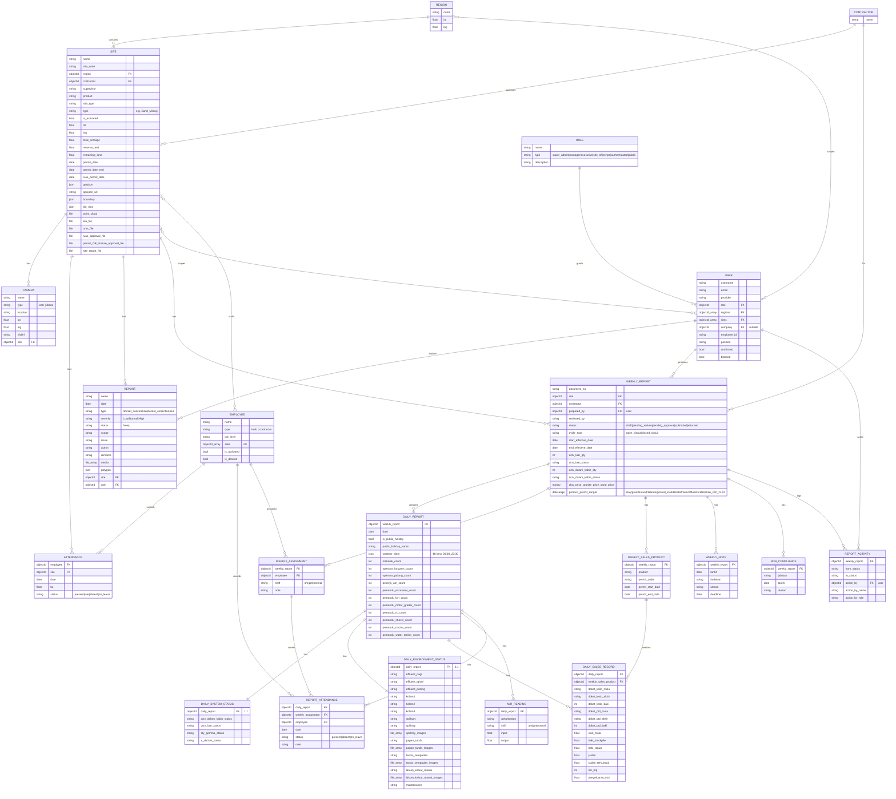

# Entity‑Relationship Diagram & Data Dictionary
## Smart Monitoring System — companion to `SRS.md`

- **Source:** live Strapi v3 / MongoDB backend `https://selgem-api.inference.asia`, captured 2026‑11‑11.
- **Note:** MongoDB document store. Every collection has `_id` (ObjectId, exposed as `id`), `__v`, `createdAt`, `updatedAt`. Relations are ObjectId references (Mongoose `ref`). "FK" below = reference field.

---

## 1. ER diagram (Mermaid)

---

## 2. Relationship summary
| Parent | Child | Cardinality | Link field |
|---|---|---|---|
| region | site | 1 : N | `site.region` |
| contractor | site | 1 : N | `site.contractor` |
| contractor | weekly-report | 1 : N | `weekly_report.contractor` |
| site | camera | 1 : N | `camera.site` |
| site | attendance | 1 : N | `attendance.site` |
| site | report | 1 : N | `report.site` |
| site | weekly-report | 1 : N | `weekly_report.site` |
| role | user | 1 : N | `user.role` |
| region | user | M : N | `user.regions[]` |
| site | user | M : N | `user.sites[]` |
| site | employee | M : N | `employee.sites[]` |
| user | report | 1 : N | `report.user` |
| user | weekly-report | 1 : N | `weekly_report.prepared_by` |
| employee | attendance | 1 : N | `attendance.employee` |
| employee | report-attendance | 1 : N | `report_attendance.employee` |
| employee | weekly-assignment | 1 : N | `weekly_assignment.employee` |
| weekly-report | daily-report | 1 : N | `daily_report.weekly_report` |
| weekly-report | weekly-assignment | 1 : N | `weekly_assignment.weekly_report` |
| weekly-report | weekly-sales-product | 1 : N | `weekly_sales_product.weekly_report` |
| weekly-report | weekly-note | 1 : N | `weekly_note.weekly_report` |
| weekly-report | non-compliance | 1 : N | `non_compliance.weekly_report` |
| weekly-report | report-activity | 1 : N | `report_activity.weekly_report` |
| daily-report | daily-system-status | 1 : 1 | `daily_system_status.daily_report` |
| daily-report | daily-environment-status | 1 : 1 | `daily_environment_status.daily_report` |
| daily-report | daily-sales-record | 1 : N | `daily_sales_record.daily_report` |
| daily-report | avr-reading | 1 : N | `avr_reading.daily_report` |
| daily-report | report-attendance | 1 : N | `report_attendance.daily_report` |
| weekly-sales-product | daily-sales-record | 1 : N | `daily_sales_record.weekly_sales_product` |
| weekly-assignment | report-attendance | 1 : N | `report_attendance.weekly_assignment` |
| user | report-activity | 1 : N | `report_activity.action_by` |

---

## 3. Notes for rebuild
1. **Three aggregate roots:** `site` (master data + geo/cameras), `weekly-report` (F001 header), `daily-report` (F001 body). Most volume hangs off `daily-report`.
2. **1:1 pairs** (`daily-system-status`, `daily-environment-status`) could be embedded sub‑documents in a rebuild; they are separate collections in the current Strapi v3 model.
3. **`weather_slots`** is a JSON/map object with 48 fixed half‑hour keys (`00:00`…`23:30`) → a weather code each. Model as JSON or a child table of (time, code).
4. **Denormalised actor fields** on `report-activity` (`action_by_name`, `action_by_role`) are kept for audit stability even if the user later changes — preserve this.
5. **File fields** (`*_file`, `*_images`, `media`, `point_cloud`) are Strapi upload references; in a rebuild model them as a media/attachment table with polymorphic owner.
6. **Indexes to add:** `daily_report.date`, `daily_report.weekly_report`, `avr_reading.daily_report`, `report_attendance.daily_report`+`employee`, `attendance.site`+`date`, `weekly_report.site`+`status`.
7. **Docket integrity:** validate `doket_*_mula/akhir/baki` continuity and that `jualan_terkumpul`/`baki_stockpile` reconcile across consecutive days.

---

## 4. Additional entities (second‑pass discovery — from role permissions)
These 17 content types were discovered from the Strapi permission model and schema‑captured on 2026‑11‑11. They complete the model (total ≈ 38 content types).

### 4.1 Diagram (Mermaid) — additional entities

```mermaid
erDiagram
    SITE                  ||--o{ SITE_POLYGON          : boundary
    SITE                  ||--o{ SITE_STANDOFF         : buffer
    SITE                  ||--o{ SITE_GALLERY          : photos
    SITE                  ||--o{ SITE_GALLERY_CAPTION  : captions
    SITE                  ||--o{ POINT_CLOUD           : scans
    SITE                  ||--o{ TILE                  : map_tiles
    SITE                  ||--o{ LANDOWNER_MONTHLY_REPORT : reports
    SITE                  ||--o{ COMPLAINT_FILE        : complaints
    SITE_TYPE             ||--o{ SITE                  : classifies
    SITE_PRODUCT          ||--o{ SITE                  : produces

    WEEKLY_REPORT         ||--o{ WEEKLY_EQUIPMENT_ENTRY : lists
    EQUIPMENT_ITEM_TYPE   ||--o{ WEEKLY_EQUIPMENT_ENTRY : typed_as
    WEEKLY_EQUIPMENT_ENTRY||--o{ EQUIPMENT_DAILY_COUNT  : counted_daily
    DAILY_REPORT          ||--o{ EQUIPMENT_DAILY_COUNT  : on_day
    USER                  ||--o{ MONITORING_REPORT      : uploads
    USER                  ||--o{ COMPLAINT_FILE         : uploads

    WEEKLY_EQUIPMENT_ENTRY {
        objectId weekly_report FK
        objectId item_type FK "equipment-item-type"
        string brand
        string owner
        string specification
        string note
        file_array images
    }
    EQUIPMENT_ITEM_TYPE {
        string name
        string code
        string category
        int    display_order
    }
    EQUIPMENT_DAILY_COUNT {
        objectId weekly_equipment_entry FK
        objectId daily_report FK
        int count
    }
    SITE_TYPE   { string name }
    SITE_PRODUCT{ string name }
    SITE_SALE   { string _placeholder "collection empty (0 rows)" }
    SITE_BUDGET { string _placeholder "collection empty (0 rows)" }
    SITE_POLYGON {
        objectId site FK
        string name
        date   date
        json   features "geojson"
    }
    SITE_STANDOFF {
        objectId site FK
        string name
        float  lat
        float  lng
        float  bearing
        file_array media
    }
    SITE_GALLERY {
        objectId site FK
        string name
        file_array media
    }
    SITE_GALLERY_CAPTION {
        objectId site FK
        objectId file FK
        string text
    }
    POINT_CLOUD {
        objectId site FK
        string url
    }
    TILE {
        objectId site FK
        string name
        date   date
        string url
    }
    MONITORING_REPORT {
        objectId upload_by FK "user"
        string name
        string type
        datetime published_at
        file_array files
    }
    LANDOWNER_MONTHLY_REPORT {
        objectId site FK
        objectId file FK
        date   date
        string status
        string submitted_by
        string reviewed_by
        string approved_by
    }
    COMPLAINT_FILE {
        objectId site FK
        objectId upload_by FK "user"
        string name
        string type
        file_array files
    }
```

### 4.2 Relationships (additional)
| Parent | Child | Card. | Link field |
|---|---|---|---|
| site | site-polygon | 1:N | `site_polygon.site` |
| site | site-standoff | 1:N | `site_standoff.site` |
| site | site-gallery | 1:N | `site_gallery.site` |
| site | site-gallery-caption | 1:N | `site_gallery_caption.site` |
| site | point-cloud | 1:N | `point_cloud.site` |
| site | tile | 1:N | `tile.site` |
| site | landowner-monthly-report | 1:N | `landowner_monthly_report.site` |
| site | complaint-file | 1:N | `complaint_file.site` |
| site-type | site | 1:N | `site.site_type` (master) |
| site-product | site | 1:N | product master |
| weekly-report | weekly-equipment-entry | 1:N | `weekly_equipment_entry.weekly_report` |
| equipment-item-type | weekly-equipment-entry | 1:N | `weekly_equipment_entry.item_type` |
| weekly-equipment-entry | equipment-daily-count | 1:N | `equipment_daily_count.weekly_equipment_entry` |
| daily-report | equipment-daily-count | 1:N | `equipment_daily_count.daily_report` |
| user | monitoring-report | 1:N | `monitoring_report.upload_by` |
| user | complaint-file | 1:N | `complaint_file.upload_by` |

### 4.3 Counts (2026‑11‑11)
| Entity | Count | Entity | Count |
|---|---:|---|---:|
| equipment-daily-count | 127,248 | site-standoff | 724 |
| weekly-equipment-entry | 24,008 | point-cloud | 71 |
| site-gallery-caption | 1,668 | site-polygon | 56 |
| tile | 1,497 | site-gallery | 43 |
| equipment-item-type | 23 | monitoring-report | 32 |
| site-type | 11 | landowner-monthly-report | 82 |
| site-product | 12 | complaint-file | 3 |
| site-sale | 0 (empty) | site-budget | 0 (empty) |
| iso-files | 0 (empty) | | |

> **Note:** `equipment-daily-count` (127,248) is the largest table — it is `weekly-equipment-entry × days`. `site-sale`, `site-budget`, `iso-files` are defined but empty (feature stubs). `landowner-monthly-report` has its own submit→review→approve workflow (`submitted_by/reviewed_by/approved_by/status`).

---
*End of ERD. Diagram renders in any Mermaid‑enabled viewer (GitHub, VS Code Mermaid preview, mermaid.live).*
